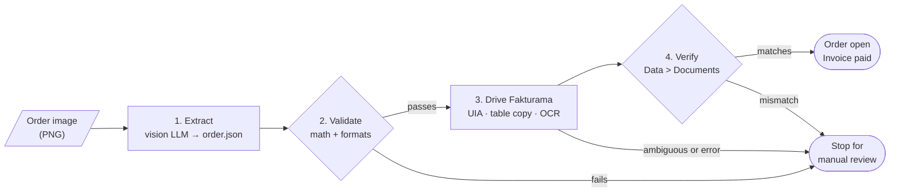

# Fakturama Image-to-Cash Automation

Turns a single order image into a saved, verified **Order** and linked **Invoice** in [Fakturama](https://www.fakturama.info/), using Microsoft UI Automation (UIA), with OCR and/or an LLM for reading the image.

> **Status:** working end to end on a test run. The final run on a fresh workspace, with screenshots, is still to come.

## How it works



1. **Extract:** a vision LLM (Google Gemini, free tier) turns the image into schema-checked JSON. The result is saved, so later runs don't call the model again. If a model is busy or doesn't answer, the next free Gemini model is tried.
2. **Validate:** line totals, net, VAT and gross must add up before Fakturama is touched.
3. **Drive Fakturama:** UI Automation finds controls by name or by their label, never by coordinates.
   - Fakturama's custom-drawn tables are read with the app's own copy.
   - An OCR check runs first, because copying an empty table crashes the app.
4. **Verify:** Data > Documents must show the Order as *open* and the Invoice as *paid*, with the image's totals.

Anything ambiguous stops the run for manual review instead of guessing.

The full reasoning, every decision and what Fakturama shows to UI Automation are in [docs/DESIGN.md](docs/DESIGN.md).

## Repository layout

```
docs/                    DESIGN.md: the design (Part 1), the decision log, and what Fakturama shows to UIA
samples/                 order.png (the input), order.expected.json (human reading),
                         order.extracted.json (Gemini's reading, reused with --from-json)
image_to_cash/
├── __main__.py          the command line: read → check → drive Fakturama → verify
├── errors.py            ManualReview: the one way the program stops
├── schema.py            the Order data: the JSON schema the LLM must follow, and the parsed result
├── extract.py           image → Order: the Gemini call, the JSON cache, the OCR witness
├── validate.py          format, line and total checks before Fakturama is touched
├── ocr.py               OCR with RapidOCR (PaddleOCR's models, offline)
├── ui.py                UI Automation helpers: find, type, choose, tables, watchdog
└── flow.py              the Fakturama steps, run() first  ← start reading here
runs/                    one folder per run: run.log + numbered screenshots (not committed)
```

## Setup

You need Windows 10 or 11, and **Fakturama 2.2.0** running with an English UI. The flow expects:
- a workspace without an Order for the same external reference
- no open "New …" editor tabs

1. Install [uv](https://docs.astral.sh/uv/). It installs the right Python (3.13) and every library from `uv.lock`:
   ```powershell
   uv sync
   ```
2. **Optional:** get a free Gemini API key at [Google AI Studio](https://aistudio.google.com/). Then create a file named `.env` in this folder (git ignores it):
   ```
   GEMINI_API_KEY=your-key
   ```
   Without a key, use `--from-json` with an already extracted order.

## How to run

```powershell
uv run python -m image_to_cash samples/order.png
```

| Option | What it does |
|---|---|
| `--from-json` | Reuses the saved JSON instead of calling Gemini (free, repeatable) |
| `--json PATH` | Reads or saves the extracted order at another path, e.g. `samples/order.expected.json` |
| `--extract-only` | Stops after extraction and checks; Fakturama isn't touched |
| `--slow [SECONDS]` | Slow motion to watch the run: waits after every action in Fakturama (1 second by default) and types slower |

While it runs, don't touch the mouse or keyboard: the program types and clicks like a user.

The exit code is `0` when everything is saved and verified, and `2` when the run stopped for manual review. In both cases the reason is in `runs/<time>/run.log`, next to the screenshots.
