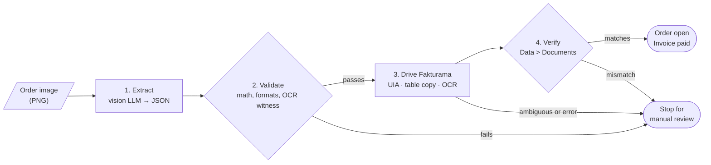

# Fakturama Image-to-Cash Automation

Turns a single order image into a saved, verified **Order** and linked **Invoice** in [Fakturama](https://www.fakturama.info/), using Microsoft UI Automation (UIA), with OCR and/or an LLM for reading the image.

> **Status:** works end to end. The brief's order, a photographed purchase order and an order sent as an email were saved and verified in Fakturama. Orders it can't handle safely stop with a reason before anything is saved.

## How it works



1. **Extract:** a vision LLM (Google Gemini, free tier) turns the image into schema-checked JSON. The result is saved, so later runs don't call the model again. If a model is busy or doesn't answer, the next free Gemini model is tried.
2. **Validate:** line totals, net, VAT and gross must add up, and every text value must also appear in OCR of the same image (RapidOCR), before Fakturama is touched.
3. **Drive Fakturama:** UI Automation finds controls by name or by their label, never by coordinates.
   - Fakturama's custom-drawn tables are read with the app's own copy.
   - An OCR check runs first, because copying an empty table crashes the app.
4. **Verify:** Data > Documents must show the Order as *open* and the Invoice as *paid*, with the image's totals.

Anything ambiguous stops the run for manual review instead of guessing.

The full reasoning, every decision and what Fakturama shows to UI Automation are in [docs/DESIGN.md](docs/DESIGN.md).

## Repository layout

```
docs/                    DESIGN.md: the design (Part 1), the decision log, and what Fakturama shows to UIA
samples/                 order.png (the input), order.expected.json (human reading),
                         order.extracted.json (Gemini's reading, reused with --from-json)
image_to_cash/
├── __main__.py          the command line: read → check → drive Fakturama → verify
├── errors.py            ManualReview: the one way the program stops
├── schema.py            the Order data: the JSON schema the LLM must follow, and the parsed result
├── extract.py           image → Order: the Gemini call, the JSON cache, the OCR witness
├── validate.py          format, line and total checks before Fakturama is touched
├── ocr.py               OCR with RapidOCR (PaddleOCR's models, offline)
├── ui.py                UI Automation helpers: find, type, choose, tables, watchdog
└── flow.py              the Fakturama steps, run() first  ← start reading here
runs/                    one folder per run: run.log + numbered screenshots (not committed)
```

## Setup

You need Windows 10 or 11, and **Fakturama 2.2.0** running with an English UI. The flow expects:
- a workspace without an Order for the same external reference
- no open "New …" editor tabs

1. Install [uv](https://docs.astral.sh/uv/). It installs the right Python (3.13) and every library from `uv.lock`:
   ```powershell
   uv sync
   ```
2. **Optional:** get a free Gemini API key at [Google AI Studio](https://aistudio.google.com/). Then create a file named `.env` in this folder (git ignores it):
   ```
   GEMINI_API_KEY=your-key
   ```
   Without a key, use `--from-json` with an already extracted order.

## How to run

```powershell
uv run python -m image_to_cash samples/order.png
```

| Option | What it does |
|---|---|
| `--from-json` | Reuses the saved JSON instead of calling Gemini (free, repeatable) |
| `--json PATH` | Reads or saves the extracted order at another path, e.g. `samples/order.expected.json` |
| `--extract-only` | Stops after extraction and checks; Fakturama isn't touched |
| `--slow [SECONDS]` | Slow motion to watch the run: waits after every action in Fakturama (1 second by default) and types slower |

While it runs, don't touch the mouse or keyboard: the program types and clicks like a user.

The exit code is `0` when everything is saved and verified, and `2` when the run stopped for manual review. In both cases the reason is in `runs/<time>/run.log`, next to the screenshots.

## What's done and what's skipped

**Done: the whole flow from the brief.**
- The order image is read by Gemini into schema-checked JSON, saved for re-runs. If a model is busy, the next free one is tried.
- Before Fakturama is touched: formats, line and total math, business rules, and every text value confirmed by OCR.
- In Fakturama: a New Order; the Debtor found or created (with both addresses and the payment method); VAT and Products found or created; item lines with quantity and discount; the Order saved; the Invoice created from it, marked paid with date and amount; both verified in Data > Documents.
- Safety: a re-run can't create a duplicate Order, and any doubt stops the run with a reason, a log, screenshots and exit code 2.
- Tested on the brief's order and on 12 more test orders: other layouts, a photo, an email, a fax, umlauts, mixed VAT, printing mistakes. The test orders aren't part of the repo.

**Skipped or not supported** (such orders stop with a reason instead):
- Documents in other languages (e.g. German), currencies other than EUR, shipping costs, order-level discounts, and payment methods other than Bank Transfer, Credit Card and SEPA Direct Debit.
- Prices whose gross price isn't a whole cent (e.g. 8.49 net): Fakturama keeps a rounded net price, large quantities end up a few cents off, and the line check stops the run.
- Delivery notes, dunning, corrections and the web-shop import.
- Cleaning up after a stopped run: records already created stay (they're valid and get reused), and an unsaved Order tab has to be closed by hand.
- Automated tests in the repo.

## If I had 3 more hours

1. **Organize the code around Fakturama's screens.** One class per screen (Order editor, Debtor editor, the address and product dialogs, the Documents list) holding its controls and actions. `flow.py` would read like the brief, and a change in Fakturama's UI would be fixed in one place.
2. **Automated tests.** Unit tests for the parts without UI (the validation math, the OCR witness, the OCR word splitting), and the test orders as a regression suite: each image's reading compared with its answer key, with `--extract-only`, so it runs without Fakturama.
3. **A local vision model as the last fallback** when Gemini can't be reached, e.g. a small Qwen2.5-VL or Gemma 3 model through Ollama: it works offline, and the image never leaves the machine. I'd measure it on the same answer keys first, and the same checks would catch its mistakes. The price: a download of several GB, and slower answers on a CPU.
4. **Close the known gaps:** enter product prices so Fakturama's net price is exact; compare the product name when an existing SKU is reused; a `--reviewed` flag to finish a run after a person checked the saved reading; let the OCR witness accept dates printed in other formats.
