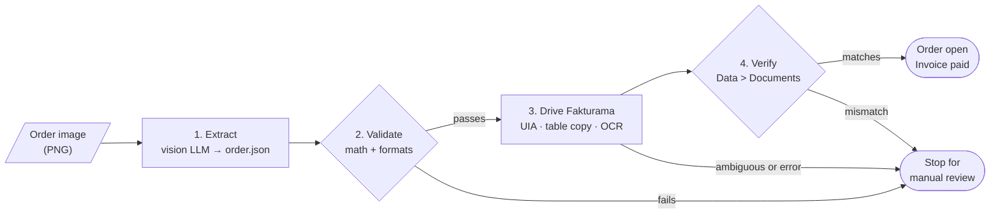
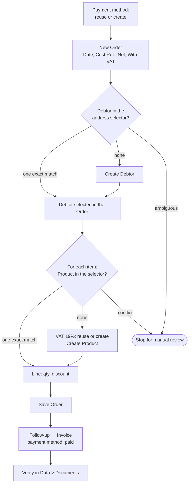

# Design: Fakturama Image-to-Cash Automation

> Part 1 of the take-home. There's no code here. The UI facts this design relies on were checked against the real app and are listed in [UI-MAP.md](UI-MAP.md) (references like *G7* point there).

## 1. Goal

- **Input:** one sales-order image, for example [`samples/order.png`](../samples/order.png).
- **Output:** in Fakturama, a saved **Order** and an **Invoice** created from it as a follow-up document. Both carry the values from the image.
  - Any missing master data is created along the way: the Debtor, the payment method, the VAT rate and the Products.
  - The Invoice is marked paid if the image says PAID.
- **Done means:** the Data > Documents list shows the Order as *open* and the Invoice as *paid*, both with the same Cust.Ref. and the source gross total. If that can't happen, the run **stops on its own**, with a clear reason, a screenshot, and a log of what was already saved.

## 2. Overview

- **One command-line Python program** runs one linear flow. It's split into small modules: the order schema, extraction, validation, OCR, UI helpers, the flow steps, and a main entry point.
- **Every step is logged and screenshotted** into `runs/<timestamp>/`.
- **Every check that fails stops the run** for manual review. The program never guesses, and never deletes or edits existing records.

## 3. Extracting data from the image

**Approach:**
- Send the image to a **vision LLM**: Google Gemini on its free tier. Require a reply that matches a fixed JSON schema (structured output), so the reply always parses.
- Save the result as `order.json`.
- A `--from-json` option lets later runs skip the model. That makes them free, fast and repeatable, and a reviewer can run the project without an API key.

**Fields:**
- external reference, order date, currency, paid status
- payment method and payment date
- debtor: company, alias, first and last name, email, phone
- billing and delivery address: name, street, ZIP, city, country
- items: SKU, description, quantity, unit, unit net price, discount %, VAT %, line net
- totals: net, VAT, gross

The image's Customer ID is read but not used, because Fakturama proposes its own.

**Normalization happens in code, not in the model:**
- dates → ISO dates
- money → `Decimal` with two places (never `float`)
- `10%` → `10`
- text trimmed
- payment method checked against the known names

**Why an LLM and not OCR here:**
- OCR returns text and positions but no meaning. Turning it into "billing street" or "line 2 discount" needs layout rules written for this one template.
- A vision model reads the structure directly.
- Its risks are handled as follows:
  - confident mistakes: caught by the validation in section 4
  - needing an API key: a free Gemini key is enough, since there's one call per image and the result is cached
  - sending data to a third party: on the free tier Google may use what it receives, which is acceptable here because the sample data is synthetic
- **Fallback when Gemini is unavailable** (overloaded, rate-limited, or no answer within 20 s):
  - The next free model is tried. There are three, each with its own capacity, and each read the sample exactly like the human reading. The fast "lite" model (about 3 s) comes first.
  - If none answers, the run stops for manual review within about a minute. A saved reading (`--from-json`) or a JSON written by hand from the image still works, and goes through the same checks.
- **OCR is not a fallback reader.** On the sample, Windows OCR reads `CHR-ERG-01` as `CHR-ERG-OI` and misses the `10%` discount completely. It's used as a second, independent reader instead (section 4), and for reading the screen (section 5).

## 4. Validating before touching Fakturama

Fakturama is only touched once all of these pass:

1. **Presence and format.** Every required field is there. Dates parse, the email looks like an email, the ZIP is digits, quantities are positive, prices are not negative.
2. **Line math.** `qty × unit_net × (1 − discount/100) = line_net`, exact to the cent.
3. **Total math.**
   - `Σ line_net = net`
   - `Σ line_net × vat/100` (rounded) `= VAT`
   - `net + VAT = gross`
4. **Business rules.**
   - The payment method has a known Fakturama code: Bank Transfer → *Credit transfer*, Credit Card → *Credit card*, SEPA Direct Debit → *SEPA direct debit*.
   - PAID requires a payment date.
5. **OCR witness.** Math can't check names or streets. So every text value from the LLM must also appear, roughly (similarity ≥ 0.7), in what Windows OCR reads from the same image. That catches invented text, not one-letter typos.
6. **Derived values** are computed once here. Example: the product's gross list price is `round(unit_net × (1 + vat/100), 2)`, which gives 297.50 and 47.60 for the sample.

If any check fails, the run stops before Fakturama is touched.

## 5. Finding and using Fakturama's controls (grounding)

Inspecting the app showed that most controls are native and named, that AutomationIds are random (G1, G2), and that **tables are custom-drawn and invisible to UIA** (G5). The rules, in order:

1. **UIA by ControlType + Name**, searched only inside the right window, dialog or editor tab.
2. **Label anchoring** for unnamed inputs (No., Date, ZIP/City, …): find the label, then take the next input of the expected type after it (G3).
3. **Unnamed icons** (select address, select product) are identified by their order next to their label. They're clicked at the center of their **UIA rectangle, read at runtime** (G11). No coordinates are ever written in code.
4. **Act like a user, then read back.**
   - Text is **typed with real keystrokes**, because Fakturama sometimes shows but doesn't save a value set through `SetValue` (G17). Dates are typed part by part (G18).
   - Buttons use `Invoke`, checkboxes use `Toggle`, and drop-downs are opened and their entry clicked (G19).
   - Every value is re-read after it's set. Where read-back doesn't work (search boxes, G15), the program checks the effect instead.
5. **Tables:**
   - First, OCR the table's rectangle (Windows OCR) to answer one question: *does it have rows?*
   - If it does, copy them (focus the table, Ctrl+A, Ctrl+C) and parse the tab-separated text (G6).
   - Copy gives exact values. OCR comes first because copying an **empty** table crashes Fakturama (G7).
   - To **select a row or edit a cell**, the program clicks where OCR sees that row's text or that column's header on a fresh screenshot (G20, G22). The position is computed at runtime.
6. **Waiting:** every action is followed by "wait until *condition* or time out": the dialog appears, the tab exists, the value equals the expected one. There are no blind sleeps.
7. **Watchdog:** before and after each step, look for unexpected windows such as "Internal Error" (G8). If one appears, take a screenshot and stop.
8. **Preconditions:**
   - Fakturama is running on the expected workspace.
   - The window is restored and focused (G12).
   - No dialog is open.

**Why no vision LLM for the screen:** it's slower, costs money on every step, and isn't deterministic. UIA plus the app's own copy covers every screen inspected so far.

## 6. The flow, step by step

The flow is **Order-first**, as the brief asks. The Order tab stays open for the whole run. After every detour, the program switches back to the Order by its tab name (G10) and re-reads Date, Cust.Ref. and Net mode.

| Step | What the program does | How it confirms | Stops for manual review when |
|---|---|---|---|
| 0 Pre-flight | Checks the preconditions. Searches Data > Documents for the Cust.Ref. | | An Order with this Cust.Ref. already exists. This prevents a duplicate on a re-run. |
| 0b Payment method | Checked for **every** order, right after pre-flight and before any editor is open. An open editor doesn't refresh its payment list (G23), and both a new Debtor and the Invoice need the method, even for an existing customer. Data > terms of payment: reused if it exists; otherwise new, with Name = Description = method, the mapped code, all days and discounts 0, not standard. Saves once. | The method appears in the Debtor's and the Invoice's payment lists. | The method has no known code, or exists twice. |
| 1 New Order | Create: New Order. Keeps the proposed No., sets Date and Cust.Ref., Net, With VAT. | Reads each field back. | A value doesn't stick. |
| 2 Debtor | Opens the address selector and searches the company. | Exactly one row where Company, First Name, Name, ZIP and City all match. Selects it, OK, then compares the Order's addresses with the image. | Several rows match, or a row has the company but differs elsewhere. |
| 2a Create Debtor | New contact. Keeps the Customer ID, Salutation `---`. Main address gets the Invoice role, plus a second address with the Delivery role when they differ. Miscellaneous: alias, 0 % discount, Net, payment method. Saves once. | Back in the Order, the new Debtor is now the one exact row. | Fakturama warns "Duplicate Contact", or it's still not found after saving. |
| 3 Products, each in image order | Opens the product selector and searches the SKU. | One row with Item No. = SKU: select, OK. | Rows conflict. |
| 3a VAT | Data > VATs, search `VAT 19%`. | Reused only if Name `VAT 19%`, value 19 and code S all match. Otherwise creates it once, without touching the standard VAT. | Same name but a different value or code. |
| 3b Create Product | Item Number = SKU, Name = Description = text, gross price (section 4), cost 0, the exact VAT, stock 0. Saves once. | Selecting it again from the Order works. | It's not found after saving. |
| 3c Line | Sets qty and line discount. | U.Price = unit net, VAT % is correct, line price = `qty × net × (1 − disc)`. | Any mismatch. |
| 4 Save Order | Overall discount 0 %, shipping free / 0.00. Saves once. | Totals equal the image. The Documents row shows the number, date, Cust.Ref., *open* and the total. | The totals differ. |
| 5 Invoice | On the saved Order: *Create a follow-up document → Invoice*, which keeps the link. Checks the copied values. Sets the payment method. If PAID: *paid*, the payment date and the full total. Saves once. | Reads the values back. | The payment method is unavailable. |
| 6 Verify | Copies the Documents rows (G6). | The Invoice is *paid* with the gross total. The Order is still *open* with the same Cust.Ref. and total. | Anything differs. |

## 7. Verification and evidence

- **Fields:** every value is read back right after it's written.
- **Records:** every created Debtor or Product is re-selected from the Order. That proves it really reached the database.
- **Money:** Fakturama's totals are compared with the image's totals as `Decimal`s, not as text (G13).
- **Final state:** the Data > Documents rows are read through copy, which gives exact raw values (G6).
- **Evidence:** `runs/<timestamp>/` holds a log and numbered screenshots. The best ones are annotated for the README.

## 8. Tradeoffs

| Choice | Gained | Given up |
|---|---|---|
| Vision LLM for the image instead of OCR + rules | Reads structure, and tolerates layout changes | Needs a free key and internet; can be confidently wrong (hence section 4) |
| UIA names and label anchoring instead of coordinates or screen vision | Survives moved or resized windows; fast; free | Depends on English labels and on the tree order |
| The app's copy for tables instead of OCR everywhere | Exact values (`100.0`, full dates) | Relies on a NatTable feature, and needs the empty-table guard (G7) |
| Reading the UI instead of the HSQLDB database | Verifies what a user sees, as the brief asks | More UI work than a SQL query |
| Order-first (the brief) instead of creating all data first | The selectors double as existence checks and save proofs | More tab switching and state to carry |
| Stop on ambiguity instead of a best guess | No wrong records in accounting data | Some runs need a human |
| One linear script instead of a framework | Easy to read and explain | Less reuse if more document types are added |

## 9. Out of scope and limitations

- **Tested scope:** Fakturama 2.2.0, English UI, en-US locale, one image per run, one currency, and the three mapped payment methods.
- **Fragile points:**
  - Unnamed icons are found by their order, and table reading depends on NatTable's copy support. A Fakturama update could break either.
  - Pre-flight checks and the watchdog make that **fail loudly, not silently**.
- **During a run:** the desktop must stay unlocked and Fakturama visible, because icon and tab clicks and OCR need real pixels.
- **Partial runs:** if a run stops midway, the master data it already created remains. Those records are valid, and the next run reuses them.
- **Not done:** delivery notes, dunning, corrections, and the web-shop import.
