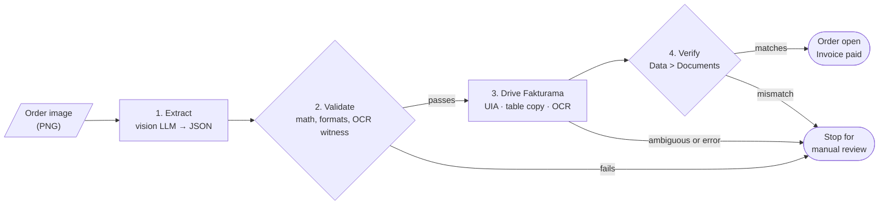
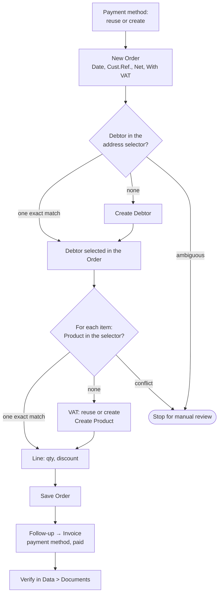

# Design: Fakturama Image-to-Cash Automation

> **Part 1 of the take-home** is sections 1–9. Two appendices follow:
> - [Appendix A](#appendix-a-decision-log): every decision, why, and the alternatives.
> - [Appendix B](#appendix-b-what-fakturama-shows-to-ui-automation): the Fakturama facts this design relies on, checked against the real app. References like *G7* point there.

## 1. Goal

- **Input:** one sales-order image, for example [`samples/order.png`](../samples/order.png).
- **Output:** in Fakturama, a saved **Order** and an **Invoice** created from it as a follow-up document. Both carry the values from the image.
  - Any missing master data is created along the way: the Debtor, the payment method, the VAT rate and the Products.
  - The Invoice is marked paid if the image says PAID.
- **Done means:** the Data > Documents list shows the Order as *open* and the Invoice as *paid*, both with the same Cust.Ref. and the source gross total. If that can't happen, the run **stops on its own**, with a clear reason, a screenshot, and a log of what was already saved.

## 2. Overview



- **One command-line Python program** runs one linear flow. It's split into small modules: the order schema, extraction, validation, OCR, UI helpers, the flow steps, and a main entry point.
- **Every step is logged and screenshotted** into `runs/<timestamp>/`.
- **Every check that fails stops the run** for manual review. The program never guesses, and never deletes or edits existing records.

## 3. Extracting data from the image

**Approach:**
- Send the image to a **vision LLM**: Google Gemini on its free tier. Require a reply that matches a fixed JSON schema (structured output), so the reply always parses.
- Save the result next to the image as `<image>.extracted.json` (for the sample, `samples/order.extracted.json`).
- A `--from-json` option lets later runs skip the model. That makes them free, fast and repeatable, and a reviewer can run the project without an API key.

**Fields:**
- external reference, order date, currency, paid status
- payment method and payment date
- debtor: company, alias, first and last name, email, phone
- billing and delivery address: name, street, ZIP, city, country
- items: SKU, description, quantity, unit, unit net price, discount %, VAT %, line net
- totals: net, VAT, gross

The image's Customer ID is read but not used, because Fakturama proposes its own.

**Normalization:**
- The prompt asks the model to copy text exactly, write dates as ISO dates (`2026-07-14`) and numbers as plain numbers (`10` for `10%`), and use `null` for anything not printed instead of guessing.
- The schema (pydantic) turns the reply into real types: dates, and money as `Decimal`, never `float`.
- Validation rounds money to cents, half up, and checks the payment method against the known names (section 4).

**Why an LLM and not OCR here:**
- OCR returns text and positions but no meaning. Turning it into "billing street" or "line 2 discount" needs layout rules written for each template.
- A vision model reads the structure directly.
- Its risks are handled as follows:
  - confident mistakes: caught by the validation in section 4
  - needing an API key: a free Gemini key is enough, since there's one call per image and the result is cached
  - sending data to a third party: on the free tier Google may use what it receives, which is acceptable here because the sample data is synthetic
- **Fallback when Gemini is unavailable** (overloaded, rate-limited, or no answer within 20 s):
  - The next free model is tried. There are three, each with its own capacity, and each read the sample exactly like the human reading. The fast "lite" model (about 3 s) comes first.
  - If none answers, the run stops for manual review within about a minute. A saved reading (`--from-json`) or a JSON written by hand from the image still works, and goes through the same checks.
- **OCR is not a fallback reader.** It returns text and positions, not meaning: turning them into fields would need layout rules for each template. (The first OCR engine, Windows' built-in one, also read `CHR-ERG-01` as `CHR-ERG-OI` and missed the `10%` discount.) OCR is used as a second, independent reader instead (section 4), and for reading the screen (section 5).

## 4. Validating before touching Fakturama

Fakturama is only touched once all of these pass:

1. **Presence and format.** Every field the schema requires is there. The reference isn't empty, there is at least one item, the email looks like an email, each ZIP is 3–10 letters, digits, spaces or dashes, quantities are positive, prices aren't negative, and discounts are between 0 and 100 %.
2. **Line math.** `qty × unit_net × (1 − discount/100) = line_net`, exact to the cent.
3. **Total math.**
   - `Σ line_net = net`
   - `Σ line_net × vat/100` (rounded) `= VAT`
   - `net + VAT = gross`
4. **Business rules.**
   - The currency is EUR.
   - The payment method has a known Fakturama code: Bank Transfer → *Credit transfer*, Credit Card → *Credit card*, SEPA Direct Debit → *SEPA direct debit*.
   - The paid status is PAID or UNPAID, and PAID requires a payment date.
5. **OCR witness.** Math can't check names or streets. So every text value from the LLM must also appear, roughly (similarity ≥ 0.7, spaces ignored), in what OCR (RapidOCR) reads from the same image. That catches invented text, not one-letter typos.
6. **Derived values** are computed from the checked data. Example: the product's gross list price is `round(unit_net × (1 + vat/100), 2)`, which gives 297.50 and 47.60 for the sample.

If any check fails, the run stops before Fakturama is touched.

## 5. Finding and using Fakturama's controls (grounding)

Inspecting the app showed that most controls are native and named, that AutomationIds are random (G1, G2), and that **tables are custom-drawn and invisible to UIA** (G5). The rules, in order:

1. **UIA by ControlType + Name**, searched only inside the right window, dialog or editor tab.
2. **Label anchoring** for unnamed inputs (No., Date, ZIP/City, …): find the label, then take the next input of the expected type after it (G3).
3. **Unnamed icons** (select address, select product) are identified by their order next to their label. They're clicked at the center of their **UIA rectangle, read at runtime** (G11). No coordinates are ever written in code.
4. **Act like a user, then read back.**
   - Text is **typed with real keystrokes**, because Fakturama sometimes shows but doesn't save a value set through `SetValue` (G17). Dates are typed part by part (G18).
   - Buttons use `Invoke`, checkboxes use `Toggle`, and drop-downs are opened and their entry clicked (G19).
   - Every value is re-read after it's set. Where read-back doesn't work (search boxes, G15), the program checks the effect instead.
5. **Tables:**
   - First, OCR the table's rectangle (RapidOCR) to answer one question: *does it have rows?*
   - If it does, copy them (focus the table, Ctrl+A, Ctrl+C) and parse the tab-separated text (G6).
   - Copy gives exact values. OCR comes first because copying an **empty** table crashes Fakturama (G7).
   - To **select a row or edit a cell**, the program clicks where OCR sees that row's text or that column's header on a fresh screenshot (G20, G22), computed at runtime. Before each such screenshot the mouse moves to the window's title bar, so no tooltip covers the table (G29). The Debtor's row is clicked as "the only row" after its search is narrowed to one customer number (G28), and a column is located before its line is edited (G30).
   - In Data > Documents, every lookup first selects the category it needs, *Orders* or *Invoices*, because Fakturama remembers a category filter (G31).
6. **Waiting:** controls, dialogs and tabs are waited for with a timeout (10 s), and values are read back to confirm an action worked. On top of that there are short fixed pauses (0.3–2 s) after actions Fakturama needs time to process, such as filtering a list after a search.
7. **Watchdog:** at pre-flight and after every save, the program looks for error and warning dialogs such as "Internal Error" or "Duplicate Contact" (G8, G24). Closing an editor that still asks to save also stops the run (G25). Each stop leaves a screenshot.
8. **Preconditions:**
   - Fakturama is running: its main window is found by its title, `Fakturama - <workspace path>`. Which workspace it is isn't checked.
   - The window is restored and focused (G12).
   - No dialog is open, and no editor tab is open under a name the program is about to use ("New Order", …).

**Why no vision LLM for the screen:** it's slower, costs money on every step, and isn't deterministic. UIA plus the app's own copy covers every screen used.

## 6. The flow, step by step

The flow is **Order-first**, as the brief asks. The Order tab stays open for the whole run. After every detour, the program switches back to the Order by its tab name (G10) and re-reads Date, Cust.Ref. and Net mode.



| Step | What the program does | How it confirms | Stops for manual review when |
|---|---|---|---|
| 0 Pre-flight | Checks the preconditions. Searches Data > Documents, category *Orders*, for the Cust.Ref. (Fakturama remembers the last category chosen there, so it's always set, G31.) | | An Order with this Cust.Ref. already exists. This prevents a duplicate on a re-run. |
| 0b Payment method | Checked for **every** order, right after pre-flight and before any editor is open. An open editor doesn't refresh its payment list (G23), and both a new Debtor and the Invoice need the method, even for an existing customer. Data > terms of payment: reused if it exists; otherwise new, with Name = Description = method, the mapped code, all days and discounts 0, not standard. Saves once. | The method appears in the Debtor's and the Invoice's payment lists. | The method has no known code, or exists twice. |
| 1 New Order | Create: New Order. Keeps the proposed No., sets Date and Cust.Ref., Net, With VAT. | Reads each field back. | A value doesn't stick. |
| 2 Debtor | Opens the address selector and searches the company. | Exactly one row where Company, First Name, Name, ZIP and City all match. Selects it, OK, then compares the Order's addresses with the image. | Several rows match, or a row has the company but differs elsewhere. |
| 2a Create Debtor | New contact. Keeps the Customer ID, Salutation `---`. Main address gets the Invoice role, plus a second address with the Delivery role when they differ. Miscellaneous: alias, 0 % discount, Net, payment method. Saves once. | Back in the Order, the new Debtor is now the one exact row. | Fakturama warns "Duplicate Contact", or it's still not found after saving. |
| 3 Products, each in image order | Opens the product selector and searches the SKU. Fakturama adds the product by itself when the search leaves one match (G21). | The new line's Item No. is the SKU. | Several products have the SKU. |
| 3a VAT | Data > VATs, search `VAT <n>%`. | Reused only if Name `VAT <n>%`, the value and code S all match. Otherwise created once, without touching the standard VAT. | Same name but a different value or code. |
| 3b Create Product | Item Number = SKU, Name = Description = text, gross price (section 4), cost 0, the exact VAT, stock 0. Saves once. | Selecting it again from the Order works. | It's not found after saving. |
| 3c Line | Sets qty and line discount. | Copies the line back: qty, U.Price = unit net, VAT %, discount, line price = `qty × net × (1 − disc)`. | Any mismatch. |
| 4 Save Order | Overall discount 0 %, shipping free / 0.00. Saves once. | Totals equal the image. The tab is renamed to the new Order number. | The totals differ. |
| 5 Invoice | On the saved Order: *Create a follow-up document → Invoice*, which keeps the link. Checks the copied values. Sets the payment method. If PAID: *paid*, the payment date and the full total. Saves once. | Reads the values back. | The payment method is unavailable. |
| 6 Verify | Copies the Documents rows (G6), once under *Orders* and once under *Invoices*. | The Invoice is *paid* with the gross total. The Order is still *open* with the same Cust.Ref. and total. | Anything differs. |

## 7. Verification and evidence

- **Fields:** every value is read back right after it's written.
- **Records:** every created Debtor or Product is re-selected from the Order. That proves it really reached the database.
- **Money:** Fakturama's totals are compared with the image's totals as `Decimal`s, not as text (G13).
- **Final state:** the Data > Documents rows are read through copy, which gives exact raw values (G6).
- **Evidence:** `runs/<timestamp>/` holds a log and numbered screenshots of every step, plus `stopped.png` when a run stops.

## 8. Tradeoffs

| Choice | Gained | Given up |
|---|---|---|
| Vision LLM for the image instead of OCR + rules | Reads structure, and tolerates layout changes | Needs a free key and internet; can be confidently wrong (hence section 4) |
| UIA names and label anchoring instead of coordinates or screen vision | Survives moved or resized windows; fast; free | Depends on English labels and on the tree order |
| The app's copy for tables instead of OCR everywhere | Exact values (`100.0`, full dates) | Relies on a NatTable feature, and needs the empty-table guard (G7) |
| Reading the UI instead of the HSQLDB database | Verifies what a user sees, as the brief asks | More UI work than a SQL query |
| Order-first (the brief) instead of creating all data first | The selectors double as existence checks and save proofs | More tab switching and state to carry |
| Stop on ambiguity instead of a best guess | No wrong records in accounting data | Some runs need a human |
| One linear script instead of a framework | Easy to read and explain | Less reuse if more document types are added |

## 9. Out of scope and limitations

- **Tested scope:** Fakturama 2.2.0, English UI, en-US locale, one image per run, one currency, and the three mapped payment methods.
- **Fragile points:**
  - Unnamed icons are found by their order, and table reading depends on NatTable's copy support. A Fakturama update could break either.
  - Pre-flight checks and the watchdog make that **fail loudly, not silently**.
- **During a run:** the desktop must stay unlocked and Fakturama visible, because icon and tab clicks and OCR need real pixels.
- **Partial runs:** if a run stops midway, the master data it already created remains. Those records are valid, and the next run reuses them.
- **Not done:** delivery notes, dunning, corrections, and the web-shop import.

---

## Appendix A: Decision log

Every decision in this project: what was chosen, why, and what else was considered.

| # | Date | Decision | Why | Alternatives considered |
|---|---|---|---|---|
| 1 | 2026-11-20, changed 2026-11-22 | Keep the design, this decision log and the Fakturama facts as **one Markdown file inside the repo** (`docs/DESIGN.md`). At first they were three files. | Reviewers get the design and the code in one place, git tracks changes to both, and one detailed document is easier to read than three. | A separate Google Doc or PDF; three files. |
| 2 | 2026-11-20 | Use **uv** to manage Python and dependencies. | One tool installs the right Python version, creates `.venv`, and writes a lockfile (`uv.lock`) so the reviewer gets the exact same versions. | `python -m venv` + `pip` + `requirements.txt` (more steps, no automatic lockfile). |
| 3 | 2026-11-20 | Pin **Python 3.13**. | On Python 3.15, `comtypes` (used by `uiautomation`) prints a compatibility warning. 3.13 is stable and fully supported. | Stay on 3.15.2 and live with the warning. |
| 4 | 2026-11-20 | Keep the structure simple: a few small modules, no framework. | The task is one linear flow. Simple code is easier to explain line by line. | Plugin architecture, classes for every screen, a test framework from day one. |
| 5 | 2026-11-21 | Extract with a **vision LLM, Google Gemini on the free tier**, returning schema-checked JSON, cached as `samples/order.extracted.json` (`--from-json` skips the model). | It reads the structure, not just text. Validation catches its mistakes. It costs nothing: one call per image, and the cache makes re-runs free and lets reviewers run without a key. | A paid model such as Claude (no free API tier); a local model via Ollama (free and offline, but a multi-GB download); OCR plus parsing rules (free and offline, but tied to one layout). |
| 6 | 2026-11-20 | Use the **`uiautomation`** library. | It was used to inspect Fakturama, and it worked with SWT controls and patterns. Its API is small. | `pywinauto` (UIA backend): bigger, with more ways to do the same thing. |
| 7 | 2026-11-20 | Read custom-drawn tables with the **app's own copy** (focus, Ctrl+A, Ctrl+C), guarded by an **OCR "has rows?" check**. | Copy returns exact raw values. Copying an empty table crashes Fakturama (G7). | OCR for all table text (misreads); reading the database directly (bypasses the UI). |
| 8 | 2026-11-20 | Find unnamed inputs by **label anchoring**, and unnamed icons by **order next to their label**, clicked at their runtime UIA rectangle. | No hardcoded coordinates, and it survives window moves and resizes. | Coordinates (forbidden by the brief); screen vision for every click (slow, costly). |
| 9 | 2026-11-20 | **Stop for manual review** on ambiguity, a failed check or an unexpected dialog. Report it with a log, a screenshot and an exit code. | Wrong accounting data is worse than a stopped run. | Best-guess matching; retrying blindly. |
| 10 | 2026-11-20 | Evidence: a **log and a screenshot per step** in `runs/<timestamp>/`. | Automatic, and shows exactly where a run stopped. | A screen recording (harder to annotate and review). |
| 11 | 2026-11-20 | Pre-flight: **stop if an Order with the same Cust.Ref. already exists**. | Re-running must not create a duplicate Order. | Allowing duplicates; updating the existing Order. |
| 12 | 2026-11-21 | Add an **OCR witness**: every text value from the LLM must roughly appear (similarity ≥ 0.7) in OCR of the same image (Windows OCR at first, RapidOCR since decision 19). | Math checks the numbers but can't check names or streets. A second, independent reader can. On the sample, true values score 0.80–1.00 with Windows OCR and 1.00 with RapidOCR; an invented street scores 0.56 or less. It catches invented text, not one-letter typos. | Trusting the LLM for text; exact matching (OCR misreads would cause false alarms). |
| 13 | 2026-11-21 | **Type values with real keystrokes**, then read them back. `ValuePattern` is used only for search boxes. | Fakturama sometimes shows a value set through UIA but doesn't save it (G17). Keystrokes are what a user does. | `ValuePattern.SetValue` everywhere (faster, but loses data silently). |
| 14 | 2026-11-21 | Rows and cells of custom-drawn tables are clicked where **OCR sees their text on a fresh screenshot**. | UIA can't see rows, and selecting a row needs a real click (G20, G22). The position is computed at runtime, never written in code. | Fixed offsets from the table's corner (breaks with fonts, rows or columns); keyboard navigation (unreliable in these tables). |
| 15 | 2026-11-21, changed 2026-11-22 | **Resolve the payment method at the start of every order**, right after pre-flight and before any editor is open (the brief does it from inside the Debtor editor). At first this happened only when a Debtor was created; a test with an existing customer paying by a method never used before then stopped at the Invoice, after the Order was saved. | An open editor doesn't refresh its payment list (G23), the Debtor must be saved only once, and the Invoice needs the method even when the customer already exists. The result is the same records. | Saving the Debtor twice; closing an unsaved editor (unreliable, G25); creating the method from the Invoice step (its open editor wouldn't see it). |
| 16 | 2026-11-21 | **Never close an editor with unsaved changes.** Every editor the program opens is saved once, then closed. | The "Save Parts" prompt can't be driven reliably (G25), and a wrong answer would save unwanted records. | Discarding via the prompt. |
| 17 | 2026-11-21 | Keep a **flat module layout**: one file per job (`schema`, `extract`, `validate`, `ocr`, `ui`, `flow`), with `flow.run()` listing the steps at the top of `flow.py`. The data classes live in `schema.py`, not `models.py`: in an LLM project, "model" should mean only the AI model. | The whole program is about 1,500 lines and one linear flow; a few files are quicker to navigate and explain. | Packages per stage with one module per step (tried, then reverted). The next step would be page objects (one class per Fakturama screen). |
| 18 | 2026-11-21 | **Fallback when Gemini is unavailable: other free Gemini models, then manual review.** Three models are tried in order, the fast "lite" one first. 404, 429, 5xx and no answer within 20 s mean "try the next one". If none answers, the run stops within about a minute; `--from-json` still works. | Google's 503 "high demand" made the program look stuck, sometimes for minutes. Each model has its own capacity. Measured on 2026-11-21: 3.5-flash-lite answered in about 3 s, 3.5-flash and 3.6-flash in about 17 s, all three exactly like the human reading; 3.7 and 3.8 answered 503 or hung every time. A weaker model's mistakes are caught by the same checks (math, OCR witness). Failing fast matters more than waiting: a saved reading is the real fallback. | OCR plus layout rules as the fallback reader (measured on the sample with Windows OCR: it misreads the SKU `CHR-ERG-01` as `CHR-ERG-OI` and misses the `10%` discount); waiting and retrying (minutes of waiting, often for nothing); a paid model (not free); a local model via Ollama (multi-GB download). |
| 19 | 2026-11-22 | **Use RapidOCR** (PaddleOCR's models, run on the CPU with ONNX Runtime) instead of Windows' built-in OCR. The `rapidocr_onnxruntime` package bundles its models, so it works offline and downloads nothing. Three adaptations: words are split where RapidOCR merged two table cells (a gap wider than 1.6 characters); clicks match the wanted text inside a longer word; the Debtor's row is clicked as the only row after the search is narrowed to one customer number. The witness ignores spaces. | It reads faint and noisy text better: replaying all 105 saved screenshots, it passed every decision Windows OCR passed, plus the two faint Discount headers Windows OCR couldn't read. The witness got stronger: lowest score 1.00 on the sample instead of 0.80, and the noisy fax passes; made-up values still score 0.56 or less. It's also an engine widely used in practice. The cost: about 0.9 s per screenshot instead of 0.1 s, and about 60 MB of dependencies. | Windows OCR (no install, fast, but blind to faint headers and noisy scans); RapidOCR with an English recognition model (would keep spaces, but needs a model download); a cloud OCR (account, key, internet, data leaves the machine). |

---

## Appendix B: What Fakturama shows to UI Automation

Findings from inspecting Fakturama 2.2.0 on Windows 10 with Microsoft UI Automation, first before writing any automation code, then while building it. They ground section 5.

Legend: ✅ visible and usable through UIA · ⚠️ visible but needs a workaround · ❌ not visible to UIA

### General findings

| # | Finding | Consequence for the design |
|---|---|---|
| G1 | Fakturama is an Eclipse/SWT app. Most controls are native Win32 controls (`Edit`, `Button`, `ComboBox`, `Static`) with readable **Names** taken from their labels. | ✅ Find controls by **ControlType + Name**. |
| G2 | **AutomationIds are random numbers** that change on every start. | Never use AutomationId. |
| G3 | Some inputs have **no Name** (e.g. No., Date, First/Last name, ZIP/City, the Gross/Net combo). Their label is a separate `Text` control placed just before them in the tree. | ⚠️ "Label anchoring": find the label, then take the next input of the expected type after it. |
| G4 | Text fields support **ValuePattern** (set and read text), buttons support **InvokePattern**, checkboxes support **TogglePattern**. | ✅ Buttons and checkboxes are used through their patterns, and values are read back through ValuePattern. Text is typed, though (G17). |
| G5 | **Tables are custom-drawn** (Eclipse NatTable). UIA shows one empty pane with no rows or cells. This applies to the search dialogs, the Order's item list and the Data lists. | ❌ Rows can't be read with UIA. See G6. |
| G6 | The tables support **copy**: focus the table (UIA `SetFocus`), press Ctrl+A, then Ctrl+C. Every row lands on the clipboard as tab-separated text with raw values (numbers like `100.0`, full dates). | ✅ Read rows exactly, with no OCR errors. |
| G7 | **Ctrl+C on an empty table crashes**: Fakturama shows an "Internal Error" dialog (`NullPointerException ... "this.copiedCells" is null`). | ⚠️ Check first whether the table has rows (OCR on the table's rectangle) and copy only if it does. |
| G8 | Error dialogs are top-level windows named **"Internal Error"** (class `#32770`), and their text contains the exception. | ✅ A watchdog can detect them by name and stop the run. |
| G9 | Dialogs (e.g. "Select the address") appear as **child windows of the main window**. While a dialog is open, clicks on the main window are ignored. | Search for dialogs under the main window, and always close them (OK or Cancel). |
| G10 | Editors open as **tabs**, named after the document (`PO000001`, `INV000001`, `New Debtor`). `SelectionItem.Select()` fails on these tabs. | ⚠️ Switch tabs by clicking the tab item's UIA rectangle (computed at runtime). |
| G11 | Some icons (next to "Addresses" and "Items") are `Image` controls with **no Name and no InvokePattern**. | ⚠️ Find them by order next to their label and click the center of their UIA rectangle. |
| G12 | When the window is **minimized**, the tree exists but every rectangle is off-screen. uiautomation's `Restore()` didn't restore it; Win32 `ShowWindow(SW_RESTORE)` did. | Restore and focus the window before any click. |
| G13 | The UI uses the **en-US locale**: dates show as `Nov 20, 2026` and money as `$100.00`. | Convert dates to the UI format when typing, and compare money as numbers rather than as text. |
| G14 | **Windows' built-in OCR engine** (`Windows.Media.Ocr`, en-US) is installed. Tesseract isn't. | Used at first: nothing extra to install. Replaced by RapidOCR, which reads faint and noisy text better (decision 19). |
| G15 | The **search boxes** accept `SetValue`, and the list filters correctly, but reading their value back returns `''`. | For these boxes, verify the effect (the filtered rows) instead of the read-back. |
| G16 | An **open editor tab can show old data**: an invoice tab showed *paid* unticked while Data > Documents said *paid*. | Final verification reads the Documents list, not an editor that was already open. |
| G17 | Text set through `ValuePattern` is **sometimes not stored**. The Company field and the money fields showed the text but saved nothing. Real keystrokes are always stored. | ⚠️ Type every value key by key, then read it back. |
| G18 | **Date fields** are edited one part at a time. Home goes to the month, and each part jumps to the next after two digits, so the arrow keys skip a part. | Type `MM`, `DD`, `YYYY` after Home, then check the shown date. |
| G19 | **Drop-downs**: picking an entry through UIA alone isn't reliable. Some entries have a trailing space. | Open the list, click the entry, then read the value back. |
| G20 | In the **search dialogs**, a row counts as selected only after a real click. Ctrl+A and the arrow keys don't select it. | ⚠️ OCR finds the row on a fresh screenshot, and the program clicks there (for the Debtor's row, see G28). |
| G21 | The **product dialog adds the product by itself** when the search leaves exactly one match. | Always check the Item No. of the line that was just added. |
| G22 | **Item lines** are edited by clicking a cell, typing, then Enter. Windows OCR couldn't read the short "Qty." header. An edited cell leaves a hidden in-place editor inside the table. | Find the Discount cell by its header (G30) and the Qty cell by its value (`1.00`, left of "Item No.", G29). The table finder tolerates that leftover editor. |
| G23 | An open **Debtor editor doesn't refresh** its payment drop-down after a new payment method is saved. | Resolve the payment method at the start of every order, before any editor is open (decision 15). |
| G24 | Saving a contact whose name and street already exist shows a **"Duplicate Contact"** warning. | The watchdog stops the run. |
| G25 | The **"Save Parts"** prompt (closing an unsaved editor) can't be reliably unticked through UIA or the keyboard, so OK may save. | The program never closes an unsaved editor. |
| G26 | Windows OCR's async calls **deadlock** in the UI Automation thread (a single-threaded COM apartment). | Applied to Windows OCR (no longer used); RapidOCR has no such problem. |
| G27 | Debtor addresses print the ZIP with a country prefix (`DE-10117 Berlin`). The Order shows only the *Invoice address* tab. | Address checks accept the prefix. |
| G28 | After a table copy (Ctrl+A), the rows **stay selected**: small bold italic text on a blue background. Scaled to 2000 px, Windows OCR read `Northstar` as `star` there. | Windows OCR needed screenshots scaled to 4000 px. RapidOCR reads the text but drops spaces there (`Northstaroffic...10117`), so the Debtor's row, after narrowing the search to one customer number, is clicked as "the only row" without reading it. |
| G29 | The mouse stays where the last click left it. On the "select a product" icon, its **tooltip** ("Pick an item from the list of all products") covers the Qty cell of the last item line, so OCR took the Discount's `0.00` as the quantity. | Before every OCR screenshot, the mouse moves to the window's title bar. The qty cell must also be left of the "Item No." header. |
| G30 | Pressing Enter in an item cell saves it, then opens the **first row's** Qty cell for editing. The column headers are light gray, and in that state OCR sometimes can't read them, so the Discount column couldn't be found. | The Discount column is located before the line is edited; afterwards only the last row's position is read again. |
| G31 | Choosing a category in the **tree left of Data > Documents** (e.g. Invoices > unpaid) filters the list, and the label before "Search:" shows it. Fakturama **remembers** the category, even after the tab is closed, and the tree has no "All" entry. A filtered list hides documents, so the duplicate check and the final verification would be blind. | Every lookup first selects the category it needs, **Orders** or **Invoices** (through UIA, which Fakturama follows), and checks the label. A parent category also shows its subcategories. |

### Screens

#### Main window: `Fakturama - <workspace path>`

| Control | Type | How to find | |
|---|---|---|---|
| New Order | Button | Name `Create: New Order` | ✅ Invoke |
| New Invoice | Button | Name `Create: New Invoice` (not used: the Invoice must come from the Order) | ✅ |
| New product | Button | Name `Create a new product` | ✅ Invoke |
| New contact | SplitButton | Name `Create a new contact` → opens "New Debtor" | ✅ Invoke |
| Save | Button | Name `Save the current contents` | ✅ Invoke |
| Menus | MenuItem | `File`, `Edit`, `Data`, `New`, `Extra`, `Window`, `Help` | ✅ |

#### Order editor (tab `PO…`)

| Control | How to find | |
|---|---|---|
| No. | first `Edit` after label `No.` | ⚠️ G3 |
| Date | first `Edit` after label `Date` | ⚠️ G3, G13 |
| Gross / Net | the unnamed `ComboBox` in the header row | ⚠️ G3 |
| Cust.Ref. | `Edit` named `Cust.Ref.` | ✅ |
| VAT mode | `ComboBox` named `VAT` (e.g. `With VAT`) | ✅ |
| Select existing address | icon 1 of 2 next to label `Addresses` | ⚠️ G11 |
| Invoice/delivery address text | `Edit` inside the tab `Invoice address` (multi-line value) | ✅ read-back |
| Select product | icon 1 of 4 next to label `Items` | ⚠️ G11 |
| Item lines | custom-drawn table | ❌ G5, read with G6 after the G7 check |
| Discount, Shipping, Total Gross, VAT, Total | named `Edit` / `ComboBox` controls | ✅ |
| Follow-up documents | buttons `Confirmation`, `Invoice`, `Delivery`, `Proforma` in group `Create a follow-up document` | ✅ Invoke |

#### "Select the address" and "Select a product" dialogs

| Control | How to find | |
|---|---|---|
| Search | `Edit` after label `Search:`. Setting it through ValuePattern filters the list. | ✅ |
| Results | custom-drawn table | ❌ G5, read with G6 after the G7 check |
| OK / Cancel | named buttons | ✅ Invoke |

Copied row formats:
- Address dialog: `No. ⇥ First Name ⇥ Name ⇥ Company ⇥ ZIP ⇥ City ⇥ address type ⇥ additional name ⇥ local consultant`
- Product dialog: `Item No. ⇥ Name ⇥ Description ⇥ Stock ⇥ Price ⇥ VAT`. The VAT column holds a Java object dump that includes `name: [...]` and `taxValue: [...]`.

#### Debtor editor (tab `New Debtor`)

- Named `Edit`s ✅: `Customer ID` (pre-filled, e.g. `CUST000002`), `Company`, `Street`, `E-Mail`, `Telephone`, `Mobile`, and so on.
- `ComboBox` `Country` ✅. It defaults to `United States`, so it must be changed.
- Unnamed ⚠️ G3:
  - Salutation combo (default `---`)
  - First name and last name: two `Edit`s after the label `First Name Last Name`
  - ZIP and city: two `Edit`s after the label `ZIP - City`
  - Address type: an `Edit` plus a button after the label `address type`
- Tabs `Addresses`, `Miscellaneous`, `Notice`. Main-address sub-tab, with a `+` button that adds another address.

#### Invoice editor (tab `INV…`)

- Same header as the Order, plus:
  - `Service date` and `Order Date` (unnamed `Edit`s after their labels)
  - follow-ups `Delivery`, `Invoice Correction`, `Dunning`
- Checkbox `paid` ✅ (Toggle).
- Payment method: unnamed `ComboBox` (e.g. `Pay Cash`). `Due Days` and `Pay Until` sit next to it.

#### Data > Documents

- Left tree (`SysTreeView32`) ✅ UIA-visible: `This transaction`, the customer, `Invoices`, `Orders`. Selecting an item filters the list (G31).
- Search box ✅, plus the custom-drawn table, read with G6. A row looks like this:

```
ICON_ORDER ⇥ PO000001 ⇥ Fri Nov 20 00:00:00 EET 2026 ⇥ <name> ⇥ <cust.ref or null> ⇥ COMMAND_ORDER_PENDING ⇥ 100.0 ⇥ null
```

State codes: `COMMAND_ORDER_PENDING` means *open*, `COMMAND_CHECKED` means *paid*.

#### More screens

- **Data menu:** `Documents`, `Products`, `Debtors`, `terms of payment`, `VATs`, …
- **VAT editor:** named `Name`, `Description`, `VAT code (E-Invoice)` (default `S (Standard rate)`), and `Value` (`0%`, a formatted field).
  - The VATs list copies as `standard? ⇥ Name ⇥ Description ⇥ value (0.19)`. It has no code column, so an existing VAT is opened to read its code.
- **Payment editor:** named `Name`, `Description`, `Cash discount`, `Discount Days` and `Net Days`.
  - The payment code drop-down is literally named `!editorPaymentPaymentcode!` (a missing translation key).
  - The payments list copies as `… ⇥ Name ⇥ Description ⇥ discount ⇥ days ⇥ days`.
- **Product editor:**
  - Named: `Item Number`, `Name`, `Description`, `Stock`, and a `VAT` drop-down that lists VAT *descriptions*.
  - `Price (gross)` and `cost price (net)` are formatted fields with no name, after their labels.
- **Debtor editor:**
  - The address type is a small popup with the checkboxes *Invoice address* and *Delivery address*. It opens from the `>` button after the label `address type`.
  - `+` adds the tab `additional address #1`.
  - The Miscellaneous tab has `Alias name`, `Payment` (lists payment *descriptions*), `Discount` and `Net or Gross`.
- **Order item lines** copy as `Qty ⇥ Item No. ⇥ Picture ⇥ Name ⇥ Description ⇥ VAT (object dump with taxValue) ⇥ U.Price (USD 250) ⇥ Discount (-0.1 = 10 %) ⇥ Price`.
- **Invoice, after ticking *paid*:** the payment drop-down (the first drop-down after *paid*), then label `at` with the date, then `Value` with the amount.
